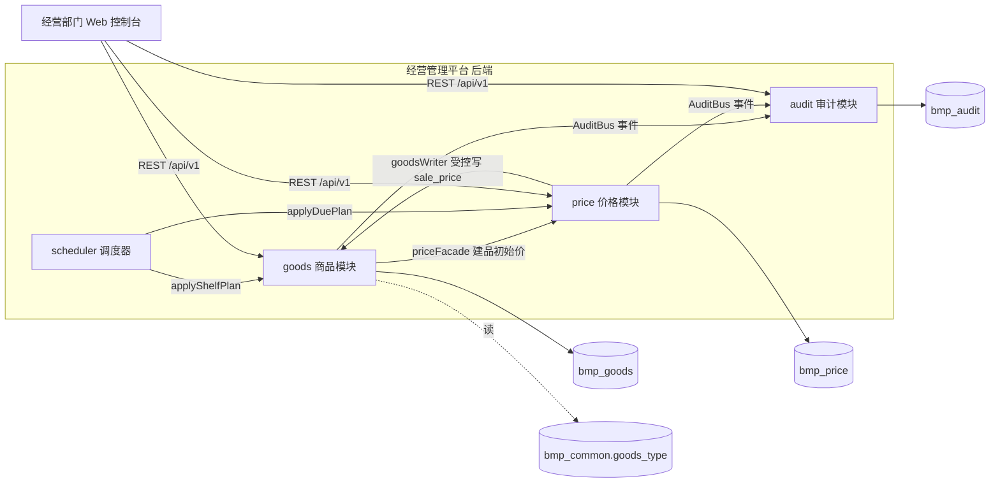

# 架构设计（一期）

## 1. 总体架构：模块化单体（Modular Monolith）

一期单部署单元、单数据库实例（4 库逻辑隔离），模块边界按「业务域」切分，模块间仅通过**接口/门面/事件**通信 —— 满足解耦铁律的同时避免微服务的分布式复杂度；后续按模块边界可平滑拆分为独立服务。

## 2. 模块与原子化拆解

| 模块 | 职责（原子操作） | 对外接口 |
|---|---|---|
| common | 错误码/统一响应/雪花ID/分页/异常中间件 | `src/common` |
| goods | 建品、编辑、详情、列表、上架、下架、定时上下架、取消计划、计划生效 | `GoodsService` + `/api/v1/goods` |
| price | 初始价、立即调价、定时调价、取消、履历查询、到期生效 | `PriceService` + `/api/v1/goods/:id/price/*` |
| audit | 事件消费落库、统一查询 | `AuditService` + `/api/v1/audits` |
| scheduler | 到期计划轮询与派发（幂等） | `Scheduler.tick()` |

每个服务方法 = 一个原子业务操作（SRP）；HTTP 层薄路由只做 zod 参数校验 + 委托。

## 3. 数据模型

- 4 库：`bmp_common`（类型注册）、`bmp_goods`（商品+计划）、`bmp_price`（价格方案）、`bmp_audit`（审计）。
- 金额 `BIGINT` 分；`unit` DECIMAL(18,6)（面额）。
- 主键自增 `id` 仅内部用；对外一律 `goods_id/price_plan_id` 雪花 CHAR(32)。
- 索引：`uk_type_sku`（SKU 唯一）、`idx_status_effective`（调度器扫描）、`idx_biz`（审计追溯）。
- 完整 DDL：`sql/001_init.sql`。

## 4. 状态机

`D 草稿 → A 在售 → S 停售 → A`（循环），`P 上架中` 为定时计划挂起态；迁移表 `TRANSITIONS` 驱动，非法迁移抛 `STATE_CONFLICT`。在售态禁止直接编辑基础信息（价格走调价接口、状态走上下架接口），保证交易侧看到的信息稳定。

## 5. 安全防御

1. **入参**：所有 HTTP 入口 zod schema（类型/长度/枚举/时间），失败统一 `400 PARAM_INVALID`。
2. **防注入**：一律参数化查询（`?` 占位），无字符串拼接 SQL（`updateStatus` 的 SET 子句来自受控白名单字面量，值仍参数化）。
3. **防泄漏**：未知异常只回 `500 INTERNAL`，堆栈仅服务端日志；DB 错误码转业务码不透 SQL。
4. **请求体上限 256KB**；分页 pageSize 上限 100，防深翻页拖库。
5. **越权**：一期单角色，`operator` 必填入审计，为后续权限模型铺路；账号/鉴权后置（预留 `x-trace-id` 贯穿链路）。

## 6. 并发控制

- **乐观锁**：`goods.version`，编辑/状态迁移 WHERE 带前置条件（version 或 status），0 行受影响 → `409`。
- **计划幂等**：`W→S`、`W→C` 均条件更新，Scheduler 与人工取消竞态时只有一方成功。
- **调度重入保护**：tick 未完成跳过本轮；多实例部署需引入 DB 分布式锁（扩展点）。
- **唯一键兜底**：SKU、待生效计划唯一性先应用层校验，再靠 DB 唯一约束兜底（`ER_DUP_ENTRY` → 409）。

## 7. 性能

- 生效价冗余于 `goods.sale_price`：读路径单表命中，价格履历仅审计/回溯时查。
- 调度器按 `status+effective_time` 索引扫描，单批 ≤100，`unref` 不阻塞进程。
- 列表查询均带索引（type+status / status+updated / operator+created_at），无跨库 JOIN（冗余字段替代）。

## 8. 扩展点

| 变更 | 改动方式 |
|---|---|
| 新商品类型 | `bmp_common.goods_type` 插一行（代码零改动） |
| 审计投递改 MQ | 替换 `InProcessAuditBus` 实现（接口不变） |
| 权限/多角色 | `operator` 已入审计；加鉴权中间件 + RBAC 表即可 |
| 优惠活动（后置） | 新增 promotion 模块，订阅价格事件，不动 goods/price 核心 |
| 多实例部署 | Scheduler 加 DB 分布式锁（`GET_LOCK` 或锁表） |

## 9. 测试策略

`test/integration.test.js`：内存 MySQL 兼容层直测真实 Service/Repository（非 mock 业务逻辑）。覆盖建品校验、状态机全链路、非法迁移、立即/定时调价生效与幂等、定时上下架生效与取消、SKU 重复、乐观锁并发冲突、审计留痕与查询、404/400 错误契约。
